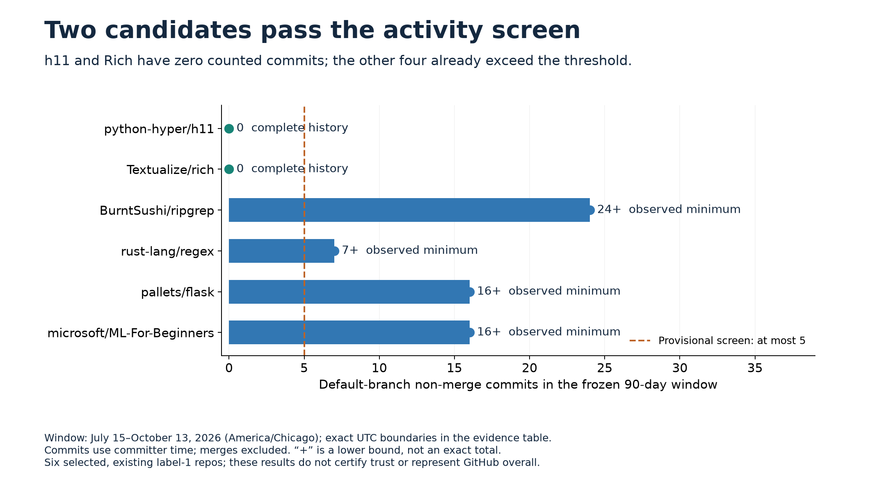
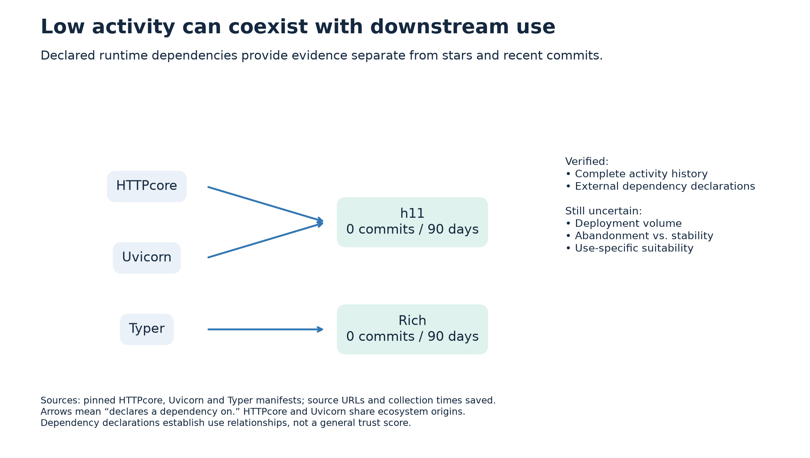
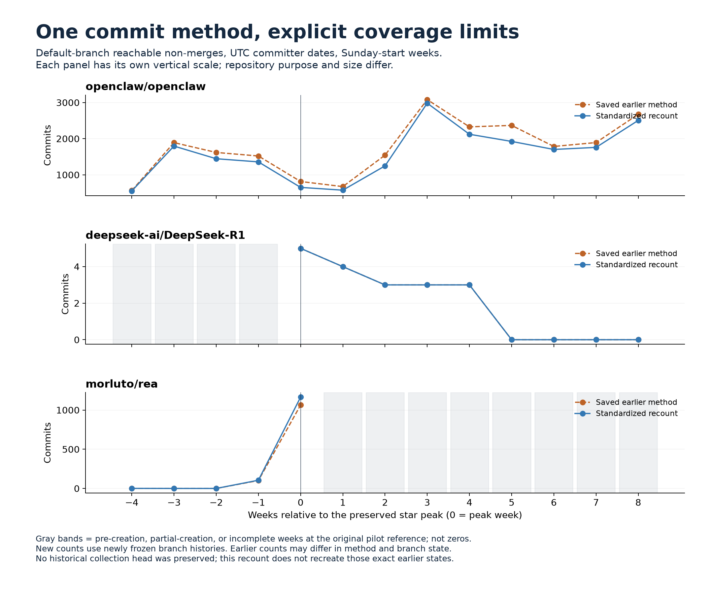
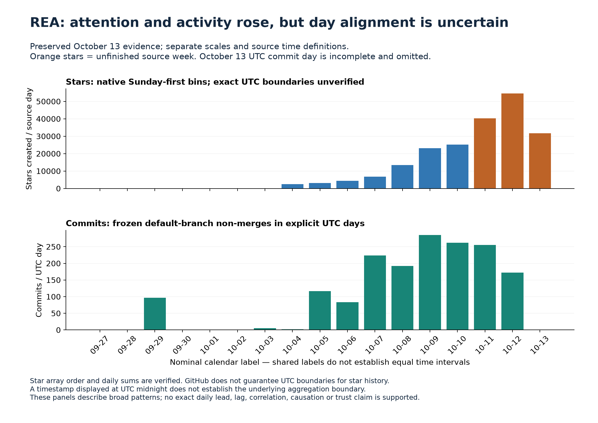
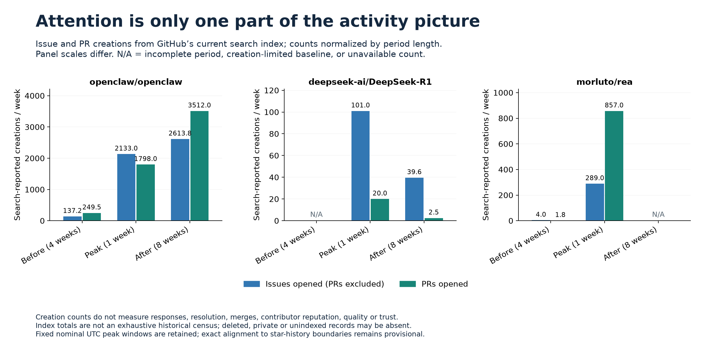
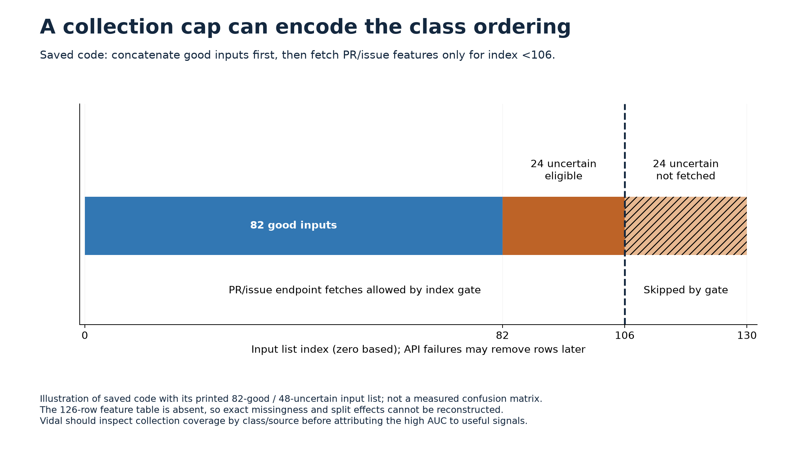
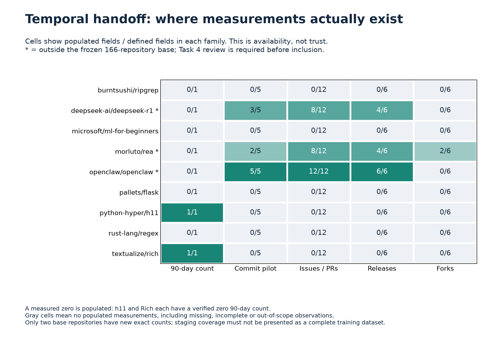

# Research findings and limits

These charts summarize saved research collections. Historical cutoffs and source coverage remain explicit; they are not current live repository assessments.

## Low activity can coexist with documented use

h11 and Rich have complete-history verified zero non-merge commits in the frozen 90-day window ending October 14, 2026 UTC. Other projects' runtime dependency declarations support continued use. This does not establish security, deployment counts, or universal trustworthiness. The four other screened candidates exceed the provisional activity threshold; their partial observations remain lower bounds. All six candidates already occur in the historical 166-repository snapshot.

## Common commit methods change the comparison

The common method counts unique root or one-parent commits reachable from a frozen branch head, using UTC committer timestamps and start-inclusive, end-exclusive weeks. OpenClaw's standardized post/pre median ratio is approximately 1.314. DeepSeek has commit activity in four of eight follow-up weeks, but no complete four-week pre-peak baseline. REA has no complete follow-up weeks at its original October 13 cutoff. New branch heads cannot recreate unknown original collection heads.

The OpenClaw aggregate 252 versus individual 249 discrepancy remains unresolved. Recounting reproduced the saved individual SHA set; it did not establish the source of the aggregate difference.

## REA timing needs explicit uncertainty

The star source's daily timezone is unverified, so exact daily lags, correlations, and causal claims are withheld. The saved sources' 64-star total difference is reproduced but unexplained. Sensitivity charts illustrate assumptions rather than recover the true boundaries.

## Engagement adds context

Issue and pull-request creations show engagement beyond commits, including for DeepSeek. Search totals reflect the current index, not a historical census; submissions do not measure response or merge quality. Release counts refer to public GitHub releases. Capped fork samples carry partial coverage flags.

## High model scores require provenance checks

Static inspection found inconsistent dataset versions, full-data median imputation before splitting, and a class-ordered collection cap. These warrant Vidal's investigation; they do not prove the cause of reported high AUC. No model was run, and the exact 126-row run matrix and split provenance were unavailable.

## Integration is staged for owner review

The outputs contain nine measured repositories and 30 candidate columns. Three pilots sit outside the frozen base; only two base repositories receive an exact new 90-day count. Unobserved values stay missing. The full Drive bundle passed offline replay checks before this selected GitHub export; this export omits its evidence cache.

